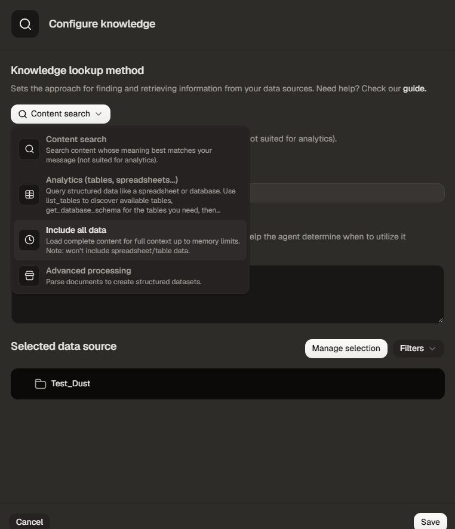
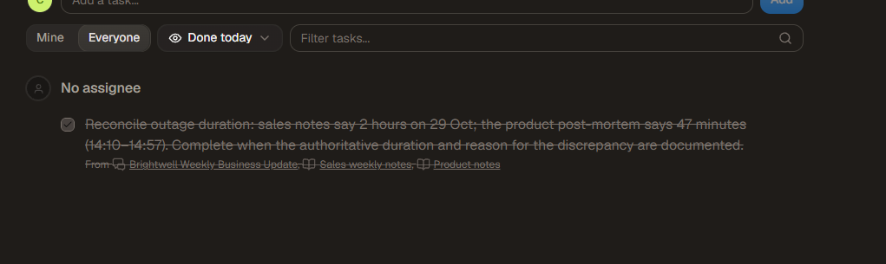

# When does an AI demo become a usable workflow?

**A hands-on Dust case study by Charles Knaepen**

I configured and tested a small operational workflow in Dust: business notes and a support-ticket table became a weekly update, tracked tasks and a document that could be revised in a later conversation. I also tested a reusable maintenance Skill and a scheduled run.

My first result was a correct but generic summary. I did not find that enough to justify another platform. I wanted to see whether the work could continue beyond the answer in the chat.

This repository contains the synthetic inputs, the configuration recipe, selected evidence and a pilot-scoping worksheet. It is an individual learning exercise, not a customer deployment, a security assessment or a comparison with competing products.

## The problem I chose

Brightwell Software is a fictional B2B software company. Its sales and product notes disagree about October recurring revenue and an outage duration. A CSV holds support tickets. Leadership needs a brief update and a way to follow through on unresolved questions without treating an AI-generated recommendation as a business decision.

I used this scenario to ask:

- Can the agent combine documentary evidence with calculations?
- Can a task retain its context and produce a persistent deliverable?
- Can new evidence update that deliverable without closing unrelated business questions?
- Can a short request invoke a reusable review method?

## What I built and checked

| Step | What happened | What I checked |
|---|---|---|
| Retrieve and calculate | Document search found the notes but could not calculate from the uploaded table. I added **Analytics** alongside **Content search**. | The answers matched the CSV: **14 Billing tickets** and **160 resolution hours for Closed Export tickets**. |
| Produce a business update | The agent combined notes and table results. | It reported **40 tickets** and **4 open High-priority tickets**, and disclosed the conflicting MRR and outage figures. The prose still needed review. |
| Continue work in a Pod | The agent created tasks linked to the original conversation and sources, then produced an internal SLA review checklist. | I inspected the task list and downloaded the file. A prepared checklist did not mean the SLA was approved. |
| Add new evidence | In a new conversation, I supplied a fictional clarification distinguishing technical unavailability from wider customer disruption. | The revised file retained the original statements and labelled the new evidence as synthetic. The outage task appeared under **Done today**; the other two remained open. |
| Apply a reusable method | I added a document-maintenance Skill, then asked for a review without pointing to the faulty sentence. | The trace loaded the Skill. The revised artifact corrected a stale recommendation and kept unresolved questions open. This was not a controlled test of the Skill's causal effect. |
| Run on a schedule | A conversational request initially used **Wait** instead of demonstrating a persistent wake-up. I then configured a schedule in the agent builder and saw it run without a new message. | The run reported writing a handoff and task states consistent with the earlier UI. The final file and the task state at that execution have not been independently inspected; schedule cleanup also remains unconfirmed. |

The [independent CSV check](scripts/check_fixture.py) recomputes the four table results without calling Dust. The [evidence notes](evidence/observations.md) distinguish artifact checks, screenshots and agent-reported actions.

## Two things the fluent answers hid

**A local edit can leave the rest of a document stale.** After the outage clarification, the checklist recorded the issue as reconciled but still recommended resolving it. I turned that review requirement into a [maintenance Skill](skills/maintain-operational-documents.md). The next revision corrected the recommendation. The [before/after example](examples/maintenance-change.md) shows the actual text.

**Producing a document, finishing a task and approving a contract are different events.** The initial handoff treated unfinished business review as unfinished checklist preparation. The task needed an explicit acceptance boundary. That is a scoping issue I would settle with a customer before relying on an automated workflow.





## How this connects to my thesis

My master's thesis, *From Cool Algorithm to Real Results: The Human Side of Making AI Work in Companies*, studies the gap between promising pilots and organizational value. I use its findings on pilot representativeness (section 4.1), governance of action (4.3), task fit and business value (4.4), and managerial implications (5.2) to interpret this exercise. The question is whether a workflow remains useful under ordinary working conditions, with clear human decisions and review effort accounted for.

This small exercise illustrates those questions; it does not validate the thesis or demonstrate enterprise-scale value. No private interviews, professional case material or full thesis are published here.

I translated that perspective into a [pilot decision sheet](pilot-decision-sheet.md): define the user's problem, agree on the output and acceptance boundary, check access to the right data, and measure review effort as well as generation speed.

## What I would test with an actual team

The missing evidence is whether someone other than the builder can use and maintain this workflow with less total effort than their current method. I would agree on a baseline and measure preparation plus review time, factual corrections, task follow-through and repeated use. I did not measure those outcomes here.

My first summary did not demonstrate a reason to switch tools. The later steps gave me a more specific question to evaluate: does keeping sources, tasks, files and reusable instructions together make ongoing work easier for a team? This exercise demonstrates parts of that mechanism, not a general advantage over OpenAI or Anthropic.

## Explore or reproduce

- [Pilot decision sheet](pilot-decision-sheet.md)
- [Configuration and replay guide](configuration.md)
- [Observed results and verification limits](evidence/observations.md)
- [Synthetic source files](data/README.md)
- [Sanitized generated artifact snapshots](examples/README.md)
- [Reusable maintenance Skill](skills/maintain-operational-documents.md)

```bash
python scripts/check_fixture.py
python -m unittest discover -s tests -v
```

Both commands use the Python standard library and make no network requests. They validate the fixture, not Dust's future answers.

**Scope and authorship:** I operated Dust and supplied its screenshots and outputs. An AI assistant helped prepare the synthetic fixture, prompts, independent checks and write-up. This is an independent candidate project, not an official Dust example. API integration, multi-user collaboration, permissions enforcement, model comparisons, production reliability and financial ROI were not tested.
