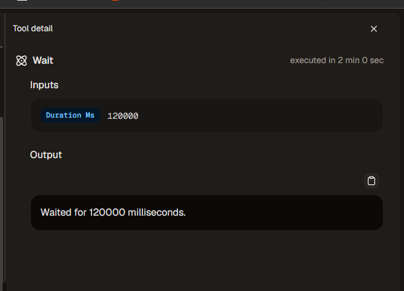

# Observations and verification limits

## How the exercise was conducted

Charles operated Dust, provided screenshots and pasted run outputs, and downloaded generated artifacts. An AI assistant prepared fictional source files and suggested prompts, recalculated the CSV results and helped write this report. This was guided familiarisation with one account and a small synthetic corpus. It was not a blind test or a benchmark against another product.

The original screenshots, actual artifact downloads and Python calculations support the observations below. Raw private chat transcripts and displayed model deliberation are not published. A model's narrated intention is not proof of a successful tool action or its root cause.

## Evidence register

| ID | Observation | Evidence available in this repository | Boundary |
|---|---|---|---|
| E01 | Document answers disclosed both MRR figures and both outage durations; missing churn and URL were not invented. | Source fixture and this account of the supplied final answers | No general accuracy rate can be inferred from this small sample. |
| E02 | Adding Analytics allowed the agent to return 14 Billing tickets and 160 Closed Export hours. | Knowledge-method screenshot; fixture calculator; recorded answer values | Exact executed SQL and raw query rows were not supplied. |
| E03 | Combined update reported 40 total tickets, 14 Billing and 4 Open High-priority. | Fixture calculator and recorded output review | A correct aggregate does not validate every sentence around it. |
| E04 | Tasks were created with source/context links; outage reconciliation later appeared Done while the other two remained open. | [Task screenshot](../assets/outage-task-done.png) and Charles's inspection of the open-task view | No multi-user handoff or permissions enforcement test was performed. |
| E05 | Checklist generation and revision produced real files. | [Artifact snapshots](../examples/README.md) | Downloads verify contents and existence, not server-side file identity or version history. |
| E06 | After the clarification, a recommendation still asked to resolve a now-reconciled issue. After a named Skill review, the recommendation changed. | [Exact before/after text](../examples/maintenance-change.md) | No same-prompt comparison without the Skill. Automatic discovery and cross-agent propagation not tested. |
| E07 | The first requested wake-up used Wait with Duration Ms 120000. | [Actual Wait detail](../assets/wait-tool-detail.png) | The action proves a delay. It does not demonstrate persistent scheduling despite the agent's final wording. |
| E08 | A schedule configured in the builder launched a run into the Pod without another message. | Charles's direct observation; supplied completed-run text reporting a handoff write and current task states | The final scheduled handoff file, cost and disabled-trigger state were not supplied for inspection. |

## Quality issues that mattered

**Ownership:** the combined update said no owner was documented for the Orbea SLA follow-up, even though the same output correctly named Amelie as drafting the clause. Drafting ownership and final approval ownership needed separate treatment.

**Labels:** the update called Delmar's amount ARR, although the source only specified a EUR 120,000 deal amount. A plausible interpretation should not silently become a source fact.

**Document consistency:** the evidence update changed facts and checked items but initially left a stale recommendation. The custom maintenance instructions required reviewing all dependent sections; the supplied next revision corrected that sentence.

**Completion:** the checklist was a preparation artifact. It did not approve the contract. One run left its task open and cited an acceptance rule in instructions that were not independently supplied. With explicit authorization, a later run closed only the outage-reconciliation task, and the UI confirmed that state. Neither observation establishes an inherent manual-only or autonomous-only completion policy.

**Handoff quality:** the earlier handoff omitted an explicit completed-task entry for outage reconciliation, expanded preparation into a full business review and referred to a credit-note variance without enough evidence of causation. It was not accepted as an authoritative business record.

**Citations:** downloaded Markdown retained raw platform citation markers and workspace file links. That does not prove a citation is broken inside Dust; its resolution mechanism and external link access were not tested. Public artifact copies here use local source links added during publication preparation.

## Scheduling evidence

A configured schedule is a different mechanism from the delay above. In the subsequent builder test, Charles entered a daily time with the Europe/Paris timezone, observed its interpreted time and saw the trigger executing in Conversations. The supplied run listed tasks, read the checklist and supporting files, then reported writing `scheduled_handoff_test.md` and task states consistent with the earlier UI. The file contents and the actual task state at that execution have not been independently inspected.

That establishes a user-observed trigger launch and a reported file write, not full acceptance of the final handoff or proof that the test recurrence was disabled. Those checks remain explicitly incomplete in this account.

## What the exercise does not establish

- No production deployment, adoption, willingness-to-pay or ROI measurement.
- No end-to-end security, residency or permissions assessment.
- No direct API integration or comparison of models.
- No comparative advantage over an OpenAI or Anthropic workflow.
- No exact current agent export, pinned model/configuration or deterministic future replay.
- No proof that the maintenance Skill alone caused the improvement.

The pilot worksheet proposes what an actual team could measure next. Its empty fields are intentional; they are not missing positive results to be filled with estimates.
